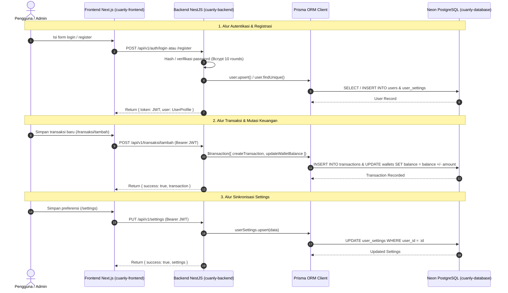
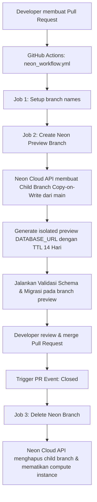

# Cuanly Database — Settings, API, and Flow Specifications

Dokumentasi spesifikasi teknis arsitektur database, konfigurasi environment, alur data (*flow*), relasi skema PostgreSQL, dan CI/CD branching Neon untuk repositori `cuanly-database`. Dokumentasi ini disinkronkan secara presisi (1:1) dengan struktur folder terbaru repo frontend (`cuanly-frontend`) dan backend (`cuanly-backend`).

---

## 1. Alignment Matrix 1:1 (Frontend -> Backend -> Database)

Struktur tabel database, DDL migrasi (`migrations/01_init.sql`), dan Prisma schema (`prisma/schema.prisma`) memetakan secara langsung setiap rute halaman di frontend Next.js dan modul controller di backend NestJS:

| Route / Folder Frontend (`cuanly-frontend/src/app`) | Module Backend (`cuanly-backend/src/modules`) | Controller Path Utama | Tabel Database Terkait (`cuanly-database`) | Deskripsi & Entitas Data |
|---|---|---|---|---|
| `(auth)/login` | `modules/auth` | `POST /api/v1/auth/login` | `users`, `user_settings` | Verifikasi kredensial via `users.username` / `users.email` terhadap `password_hash` / `pin_hash`. Mengembalikan JWT token valid. |
| `(auth)/register` | `modules/auth` | `POST /api/v1/auth/register` | `users`, `user_settings` | Pembuatan akun baru (role: `USER`, tier: `FREE`) dan inisialisasi baris preferensi default pada `user_settings` secara atomik. |
| `(user)/beranda` | `modules/beranda` | `GET /api/v1/beranda` | `transactions`, `wallets`, `categories`, `budget_limits` | Agregasi dashboard: total saldo dompet aktif, mutasi transaksi terkini (limit 5), daftar dompet kas, dan kategori pengeluaran/pemasukan. |
| `(user)/transaksi` | `modules/transaksi`, `modules/transactions` | `GET /api/v1/transaksi`, `GET /api/v1/transactions` | `transactions`, `wallets`, `categories` | Menampilkan seluruh mutasi riwayat keuangan pengguna dengan filter tipe (`EXPENSE`/`INCOME`), kategori, kata kunci, dan rentang tanggal. |
| `(user)/transaksi/[id]` | `modules/transaksi/[id]` | `GET, PUT, DELETE /api/v1/transaksi/:id` | `transactions`, `wallets`, `categories` | Operasi detail, update data mutasi individual, dan rollback saldo dompet pada `wallets.balance`. |
| `(user)/transaksi/scan` | `modules/transaksi/scan`, `modules/ocr` | `POST /api/v1/transaksi/scan`, `POST /api/v1/ocr/scan` | `transactions` (kolom `receipt` JSONB) | Penyimpanan metadata hasil pemindaian Smart OCR nota/struk belanja (nama merchant, items, nominal, confidence score, kategori saran) ke kolom JSONB. |
| `(user)/transaksi/tambah` | `modules/transaksi/tambah` | `POST /api/v1/transaksi/tambah` | `transactions`, `wallets`, `categories` | Pencatatan transaksi baru atomik: insert record ke tabel `transactions` dan mutasi saldo pada tabel `wallets`. |
| `(user)/budget` | `modules/budget`, `modules/finance` | `GET /api/v1/budget`, `GET, PUT /api/v1/budgets` | `budget_limits`, `categories`, `transactions` | Monitoring batasan anggaran belanja bulanan per kategori dan perbandingan realisasi pengeluaran berjalan. |
| `(user)/budget/[slug]` | `modules/budget/[slug]` | `GET, PUT /api/v1/budget/:slug` | `budget_limits`, `categories`, `transactions` | Detail limit budget kategori spesifik berdasarkan `categories.slug` dan constraint unik `[user_id, category_id, period]`. |
| `(user)/profil` | `modules/profil`, `modules/auth` | `GET, PUT /api/v1/profil`, `POST /api/v1/profil/avatar` | `users` | Pengelolaan data akun profil pengguna (`name`, `username`, `email`, `phone`, `avatar_url` foto profil base64/URL). |
| `(user)/settings` | `modules/settings`, `modules/users` | `GET, PUT /api/v1/settings`, `GET, PUT /api/v1/users/settings` | `user_settings` | Penyimpanan preferensi: `theme`, `locale`, `active_currency`, `monthly_allowance`, `spending_warning_threshold`, `session_timeout_ms`, preferensi OCR, dan notifikasi. |
| `pricing` | `modules/pricing` | `GET /api/v1/pricing`, `POST /api/v1/pricing/upgrade` | `users.subscription_tier`, `wallets` | Tingkatan paket (`FREE`, `SILVER`, `GOLD`, `B2B`) yang membatasi kuota dompet (`wallets`), akses utang/piutang (`debts`), dan shared workspace (`workspace_members`). |
| `admin/dashboard` | `modules/admin/dashboard` | `GET /api/v1/admin/dashboard`, `GET /api/v1/admin/stats` | `users`, `transactions`, `mitra`, `complaints` | Metrik statistik backoffice: agregasi total pengguna terdaftar, akumulasi volume transaksi platform, mitra aktif, verifikasi pending, dan komplain terbuka. |
| `admin/categories` | `modules/admin/categories` | `GET, POST /api/v1/admin/categories` | `categories` | Manajemen 9 kategori standar sistem (Hick's Law) dan penambahan kategori kustom oleh admin/pengguna. |
| `admin/transactions` | `modules/admin/transactions` | `GET /api/v1/admin/transactions` | `transactions`, `users`, `wallets`, `categories` | Audit trail seluruh mutasi transaksi pengguna di platform Cuanly. |
| `admin/users` | `modules/users` | `GET /api/v1/admin/users` | `users`, `user_settings` | Direktori pengguna, role akses (`USER`/`ADMIN`), dan tier langganan aktif. |
| `admin/users/[id]` | `modules/admin/users/[id]` | `GET, PUT /api/v1/admin/users/:id/toggle-status` | `users` | Kontrol suspensi akun pengguna dengan memperbarui boolean `users.is_active` (`true`/`false`). |
| `admin/verification` | `modules/admin/verification` | `GET /api/v1/admin/verification`, `GET /api/v1/admin/mitra` | `mitra` | Pengajuan pendaftaran mitra bisnis UMKM & korporat. |
| `admin/verification/[id]` | `modules/admin/verification/[id]` | `GET, PUT /api/v1/admin/verification/:id/verify` | `mitra` | Verifikasi berkas legalitas mitra (`PENDING`, `VERIFIED`, `REJECTED`) beserta catatan verifikator. |
| `admin/complaints` | `modules/admin/complaints` | `GET /api/v1/admin/complaints` | `complaints` | Manajemen antrean tiket komplain & keluhan transaksi pengguna. |
| `admin/complaints/[id]` | `modules/admin/complaints/[id]` | `GET, PUT /api/v1/admin/complaints/:id/status` | `complaints` | Resolusi status komplain (`OPEN`, `IN_PROGRESS`, `RESOLVED`) beserta catatan solusi `resolution_note`. |
| *(Fitur Gold+)* | `modules/debts` | `GET, POST, PUT, DELETE /api/v1/debts` | `debts` | Manajemen utang (`DEBT`) dan piutang (`RECEIVABLE`) dengan pelacakan jatuh tempo dan status pelunasan `is_settled`. |
| *(Fitur B2B)* | `modules/workspace` | `GET, POST /api/v1/workspace/members` | `workspace_members` | Kolaborasi multi-pengguna tim UMKM dengan pembagian hak akses (`OWNER`, `ADMIN`, `MEMBER`). |
| *(Fitur Global)* | `modules/users/notifications` | `GET, PUT /api/v1/notifications` | `notifications` | Notifikasi sistem overbudget, alert keuangan, dan broadcast pengumuman. |

---

## 2. Settings & Environment Configuration

### 2.1 Kebijakan Keamanan Lingkungan (Zero-Secret In Git Policy)
> [!CAUTION]
> **PERINGATAN KERAS:** File `.env` berisi kredensial database sensitif dan **DILARANG KERAS** dikomit ke Git repository.

1. **Aturan `.gitignore`**:
   - Seluruh varian file environment (`.env`, `.env.*`, `.env.local`, `.env.production`, `.env.development`) secara otomatis diabaikan oleh Git.
   - Hanya template tanpa rahasia (`.env.example`) yang boleh di-track dalam repositori.
   - Perintah `git rm --cached .env` wajib dijalankan jika file `.env` sempat terindeks secara tidak sengaja.
2. **Dual Connection String Neon PostgreSQL**:
   - `DATABASE_URL`: Connection string pooled melalui PgBouncer (`...pooler.c-4.ap-southeast-1.aws.neon.tech/neondb?sslmode=require`). Digunakan untuk runtime serverless / NestJS backend API agar koneksi database efisien dan tidak *exhausting connection limits*.
   - `DIRECT_URL`: Connection string unpooled langsung ke compute endpoint Neon (`...aws.neon.tech/neondb?sslmode=require`). Digunakan secara spesifik untuk Prisma CLI DDL migrations (`prisma db push`, `prisma migrate`) karena migrasi membutuhkan session locking yang tidak didukung penuh oleh connection pooler.
3. **Local Docker Environment Variables**:
   - `POSTGRES_DB`: Nama database lokal (`cuanly_db`).
   - `POSTGRES_USER`: Username superuser lokal (`postgres`).
   - `POSTGRES_PASSWORD`: Password lokal (`postgres`).
   - `POSTGRES_PORT`: Port exposed host (`5432`).
4. **GitHub Actions Secrets (Neon Branching CI/CD)**:
   - `secrets.NEON_API_KEY`: API Key akun Neon (disimpan sebagai GitHub Encrypted Secret).
   - `vars.NEON_PROJECT_ID`: ID project Neon Cuanly (disimpan sebagai GitHub Action Variable).

---

## 3. API & External Service Interaction

### 3.1 Neon Ephemeral Branching & Automated Sync (GitHub Actions CI/CD)
Repositori ini mengintegrasikan dua workflow GitHub Actions untuk menjamin database Neon selalu tersinkronisasi 100% dengan repositori Git:

#### A. Preview Branch per Pull Request (`.github/workflows/neon_workflow.yml`)
- **Trigger**: Pull Request event (`opened`, `reopened`, `synchronize`, `closed`)
- **Create & Sync Lifecycle**:
  - `neondatabase/create-branch-action@v6` membuat branch copy-on-write terisolasi: `preview/pr-${{ github.event.number }}-${{ branch }}` dengan masa kedaluwarsa 14 hari.
  - Secara otomatis menjalankan `npx prisma db push --schema prisma/schema.prisma --accept-data-loss` ke branch terisolasi tersebut menggunakan connection string `db_url` (unpooled).
  - Secara otomatis menjalankan `npx prisma db seed` untuk mengisi akun Live Admin, dompet, batas anggaran, 9 kategori sistem Hick's Law, mitra, dan komplain.
  - `neondatabase/schema-diff-action@v1` memposting perbandingan diff skema ke thread Pull Request.
- **Cleanup Lifecycle**:
  - Saat PR di-close / di-merge, `neondatabase/delete-branch-action@v3` menghapus branch preview dan compute endpoint terkait.

#### B. Main Database Production Sync (`.github/workflows/neon_sync_main.yml`)
- **Trigger**: Push ke branch `main` pada path `prisma/**`, `migrations/**`, `seeds/**`, `package.json`, atau `workflow_dispatch` (manual trigger).
- **Behavior**:
  - Mendapatkan connection URI database Neon secara dinamis melalui Neon API (`https://console.neon.tech/api/v2/projects/${{ vars.NEON_PROJECT_ID }}/connection_uri`) menggunakan `secrets.NEON_API_KEY` (atau fallback ke `secrets.DATABASE_URL`).
  - Menyamarkan URL dengan `::add-mask::` agar password tidak tercatat pada log runner.
  - Menjalankan `npx prisma db push` dan `npx prisma db seed` ke database utama Neon secara otomatis.

---

## 4. Flow Architecture

### 4.1 End-to-End Data & Application Flow


### 4.2 CI/CD Neon Branching Lifecycle Flow


---

## 5. Data & Schema Pipeline

### 5.1 Relasi Skema Database (Entity Relationship)
- **`users` (1) ── (1) `user_settings`**: Relasi one-to-one wajib (`ON DELETE CASCADE`).
- **`users` (1) ── (N) `wallets`**: Relasi multi-dompet (`ON DELETE CASCADE`). Tier FREE dibatasi 2 dompet di logic backend.
- **`users` (1) ── (N) `transactions`**: Seluruh riwayat pengeluaran dan pemasukan pengguna (`ON DELETE CASCADE`).
- **`wallets` (1) ── (N) `transactions`**: Transaksi opsional terikat ke dompet spesifik (`ON DELETE SET NULL`).
- **`categories` (1) ── (N) `transactions`**: Setiap transaksi wajib memiliki relasi kategori.
- **`categories` (1) ── (N) `budget_limits`**: Relasi batasan anggaran per kategori (`ON DELETE CASCADE`).
- **`users` (1) ── (N) `budget_limits`**: Constraint unik `[user_id, category_id, period]`.
- **`users` (1) ── (N) `debts`**: Pelacakan utang piutang pengguna Gold+ (`ON DELETE CASCADE`).
- **`users` (1) ── (N) `workspace_members`**: Anggota shared workspace pengguna tier B2B (`ON DELETE CASCADE`).
- **`users` (1) ── (N) `notifications`**: Notifikasi in-app pengguna (`ON DELETE CASCADE`).
- **`mitra`**: Entitas independen backoffice untuk verifikasi berkas izin UMKM / mitra bisnis.
- **`complaints`**: Entitas independen tiket aduan pelanggan dengan pelacakan `ticket_id` unik.

### 5.2 Standar Kategori Hick's Law (9 Kategori Awal)
Database menginisialisasi 9 kategori bawaan sistem (`is_system = true`, `user_id = NULL`) untuk mengurangi *cognitive load* pengguna:
1. `cat_food` (`makanan`) — Makanan & Minuman (`EXPENSE`, `#F97316`)
2. `cat_transport` (`transportasi`) — Transportasi (`EXPENSE`, `#0EA5E9`)
3. `cat_shopping` (`belanja`) — Belanja (`EXPENSE`, `#8B5CF6`)
4. `cat_entertainment` (`hiburan`) — Hiburan (`EXPENSE`, `#EC4899`)
5. `cat_health` (`kesehatan`) — Kesehatan (`EXPENSE`, `#10B981`)
6. `cat_other` (`lainnya`) — Lainnya (`EXPENSE`, `#6B7072`)
7. `cat_salary` (`gaji`) — Gaji Bulanan (`INCOME`, `#059669`)
8. `cat_freelance` (`freelance`) — Freelance & Bisnis (`INCOME`, `#2563EB`)
9. `cat_investment` (`investasi`) — Investasi & Bunga (`INCOME`, `#D97706`)

---

## 6. Security Controls

- **Enkripsi Kredensial**: Password dan PIN disimpan dalam bentuk salted hash Bcrypt (10 rounds). Tidak ada penyimpanan plain-text.
- **Perlindungan Injeksi SQL**: Seluruh interaksi database backend diatur melalui parameterized queries Prisma ORM dan DDL migrasi terkontrol.
- **Integritas Referensial**: Foreign key constraints dilengkapi kebijakan `ON DELETE CASCADE` atau `ON DELETE SET NULL` guna mencegah data yatim (*orphaned records*).
- **Enkripsi Data Transit**: Seluruh koneksi ke Neon PostgreSQL diwajibkan menggunakan Transport Layer Security (`sslmode=require`).
- **Pencegahan Kebocoran Rahasia**: Workflow CI/CD secara tegas tidak memunculkan string koneksi (`DATABASE_URL`) pada console log GitHub Actions.

---

## 7. Operations & Maintenance

### 7.1 Menjalankan Database Secara Lokal (Docker Compose)
```bash
# Menyalakan container PostgreSQL 16 & Adminer
docker compose up -d

# Memeriksa log database
docker compose logs -f

# Menghentikan container
docker compose down
```
- **PostgreSQL Connection**: `localhost:5432` (User: `postgres`, Password: `postgres`, DB: `cuanly_db`)
- **Web Adminer UI**: `http://localhost:8080` (Akses visual ke tabel dan eksekusi query SQL)

### 7.2 Migrasi dan Validasi Skema (Prisma CLI)
```bash
# Validasi integritas skema Prisma
npx prisma validate

# Format skema Prisma
npx prisma format

# Push perubahan skema langsung ke database
npx prisma db push

# Menjalankan seeder akun live admin dan kategori default
npx prisma db seed
```
